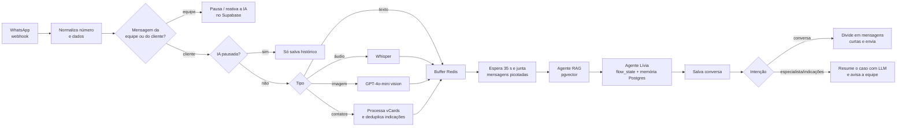

# Reativa — agente de pós-venda e reativação de clientes com IA

Agente de WhatsApp que faz o relacionamento pós-venda de uma ótica: acompanha a adaptação ao óculos novo, lembra do vencimento da receita, oferece reparo, parabeniza no aniversário e conduz um programa de indicações. Construído em n8n e colocado em operação.

**Origem:** desenvolvi o fluxo como freelancer, por **R$ 3.000**, para o OptiFlow, produto de uma agência de marketing digital especializada em óticas. Reativa é o nome que dei ao projeto pensando em dar continuidade a ele.

> Versão anonimizada para portfólio. O produto original pertence ao cliente; nome da ótica, endereço, telefones e IDs foram removidos. Nenhuma credencial está incluída.

## O problema

Óticas vendem o óculos e perdem contato com o cliente. O pós-venda (checar adaptação, avisar que a receita venceu, pedir indicações) é manual, depende de alguém lembrar e quase nunca acontece. A agência queria automatizar esse contato sem soar como robô e sem a IA inventar informação sobre preço ou produto.

## Como funciona

**129 nós funcionais**, sendo 28 de IA (agentes, cadeias LLM, embeddings, memória, transcrição e visão).

## Decisões técnicas que valem destacar

| Problema real | Solução |
|---|---|
| Cliente manda 3–4 mensagens seguidas e a IA respondia cada uma | **Debounce com Redis**: as mensagens entram numa lista por telefone; o fluxo espera 35 s e só segue se nada novo chegou, juntando tudo numa mensagem só |
| Cliente responde por áudio ou foto | Áudio → **Whisper**; imagem → **GPT-4o-mini vision** resume o conteúdo; tudo vira texto antes do agente |
| Atendente humano precisa assumir a conversa | Se a equipe responde pelo próprio WhatsApp, o fluxo detecta `fromMe` e **pausa a IA** para aquele cliente; "Atendimento finalizado" reativa depois de 1 min |
| IA não pode inventar preço, estoque ou detalhes do produto | **RAG** sobre documentos da ótica (Drive → Supabase pgvector) + regra de "se não está no prompt, encaminha para especialista" |
| Jornadas diferentes por cliente | Campo **`flow_state`** (7 dias, intermediário, 14 meses, receita vencendo, aniversário, reparo) decide o roteiro do agente |
| Programa de indicações contável | Código JS lê os **vCards**, extrai números, **deduplica** contra a base e calcula quantos faltam para o próximo múltiplo de 5 |
| Resposta longa parece robótica no WhatsApp | Uma cadeia LLM com **output parser estruturado** divide a resposta em mensagens curtas, enviadas com 1 s de intervalo |
| Equipe precisa do contexto ao assumir | Um LLM **resume a conversa** e envia para o WhatsApp da equipe com link direto do cliente |

## Stack

n8n · OpenAI (GPT-4.1-mini, GPT-4o-mini, Whisper, text-embedding-3-small) · Supabase (Postgres + pgvector) · Redis · Google Drive · uazapi (WhatsApp, nó da comunidade)

## Como rodar

1. Instale o nó da comunidade `n8n-nodes-uazapi` no seu n8n.
2. Crie as tabelas com [`schema.sql`](schema.sql) no Supabase.
3. Importe `reativa.json` no n8n e configure as credenciais: OpenAI, Supabase, Postgres, Redis, Google Drive e uazapi.
4. Substitua os placeholders: `SEU_FOLDER_ID_DO_DRIVE`, `SEU_WORKFLOW_ID_INDICACOES`, `NUMERO_DA_EQUIPE`, `[ENDEREÇO DA ÓTICA]`.
5. Rode o fluxo "Agente treinamento RAG" (gatilho manual) para indexar os documentos.
6. Aponte o webhook da sua instância de WhatsApp para `/webhook/reativa-webhook`.

## O que eu faria diferente hoje

- **Transparência sobre IA.** A versão original instruía o agente a nunca admitir ser IA; nesta versão pública ele se apresenta como assistente virtual e oferece falar com a equipe. Esconder isso fere a confiança do cliente.
- **LGPD nas indicações.** Contatos indicados são dados de terceiros; adicionaria uma mensagem de consentimento antes do primeiro contato e retenção limitada.
- **Roteamento por intenção estruturada**, em vez de procurar palavras como "especialista" no texto da resposta.
- **Menos nós repetidos:** os três ramos de divisão e envio de mensagens viram um sub-workflow.
- **Avaliação:** um conjunto de conversas de teste por `flow_state` para medir se o agente segue o roteiro antes de cada mudança de prompt.
